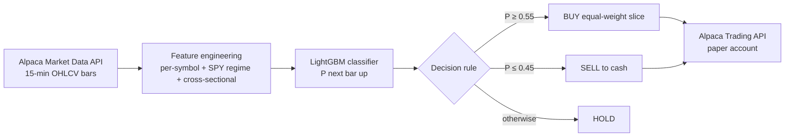

# ML Intraday Trading Bot (LightGBM + Alpaca)

An end-to-end machine-learning trading system that predicts whether a stock's next **15-minute bar** will close up, and uses that probability to trade a diversified 15-asset portfolio on an **Alpaca paper-trading account** in real time.

It covers the full lifecycle: **data ingestion → feature engineering → model training → out-of-sample backtesting → live execution.**

---

## How it works



**Universe (15 assets across sectors):** AAPL, MSFT, NVDA, AMZN (tech) · LMT, CAT (industrial/defense) · BAC, JPM (financials) · XOM (energy) · JNJ (healthcare) · PG, KO (consumer staples) · BTC, GLD, USO (bitcoin, gold and oil ETFs). SPY is used as market context.

### Features (42 total)
| Group | Features | Intuition |
|---|---|---|
| Momentum | 1, 2, 4 and 8-bar returns | Short-term trend / mean reversion |
| Volatility | 8 and 24-bar rolling std of returns | Risk regime of the asset |
| Trend | 5/15-bar moving-average ratio | Fast vs. slow trend |
| Bar structure | Close location within the high-low range | Buying/selling pressure inside the bar |
| Volume | 20-bar volume z-score | Unusual activity |
| **Market regime** | Same features computed on **SPY** | Is the whole market risk-on or risk-off? |
| **Cross-sectional** | Universe mean/std return, return relative to peers, return z-score | Is this asset leading or lagging the others right now? |
| Identity | One-hot symbol | Lets one model learn asset-specific behavior |

All features use only past data (no look-ahead). The label is `1` if the next bar's close is higher than the current close.

### Model
A single **LightGBM** gradient-boosted classifier trained on all 15 symbols (pooled panel), using 120 days of 15-minute bars and a **chronological 80/20 split** (no shuffling, so the test set is strictly in the future).

### Trading logic
Long/cash only, evaluated independently per symbol on each new bar during regular market hours:
- **Enter** when `P(up) ≥ 0.55`, sizing each position to `90% of equity / 15`.
- **Exit** to cash when `P(up) ≤ 0.45`.
- **Hold** in between. This hysteresis band avoids over-trading on noisy probabilities.

---

## Results

Out-of-sample results on the held-out test period (**Oct 1 – Oct 23, 2026**, ~16 trading days, data the model never saw during training).

**Classifier** (12,961 test bars, 49.9% "up" base rate):

| Metric | Value |
|---|---|
| ROC AUC | **0.539** |
| Accuracy | **52.7%** (vs. 50% baseline) |

**Backtest** ($100k starting capital, vs. equal-weight buy & hold of the same 15 assets):

| | ML strategy (0.55 / 0.45) | ML strategy (0.60 / 0.40) | Buy & hold |
|---|---|---|---|
| Return | +1.59% | +1.81% | +2.41% |
| Annualized Sharpe | 4.89 | **5.76** | 4.53 |
| Max drawdown | 0.96% | **0.92%** | 1.49% |
| Trades | 1,042 | 350 | — |

**Takeaways:** a small but real predictive edge (AUC 0.54) is typical for 15-minute horizons. The strategy gave up some return compared with buy & hold in a rising market, but delivered **better risk-adjusted returns** (higher Sharpe, ~35-40% lower drawdown), since it moves to cash when the model expects weakness. Stricter thresholds cut trading by 3x and improved Sharpe.

> Results are from a short window and will change each time the model is retrained on new data. See [Limitations](#limitations).

---

## Project structure

```
├── config.py               # Universe, timeframe, thresholds, credentials (single source of truth)
├── alpaca_data.py          # Historical bar downloader (training / backtest)
├── alpaca_api.py           # Trading + live market-data client wrapper
├── feature_engineering.py  # Per-symbol, SPY-regime and cross-sectional features
├── train_lgbm.py           # Builds the dataset, trains LightGBM, saves the model artifact
├── backtest_ml.py          # Out-of-sample backtest vs. buy & hold
├── ml_strategy.py          # Live feature row + probability → BUY / SELL / HOLD
├── main.py                 # Live paper-trading loop
├── strategies.py           # Moving-average crossover baseline (first version of the bot)
└── lgbm_15m.joblib         # Trained model + feature list + test-split timestamp
```

---

## Getting started

**1. Install**
```bash
git clone https://github.com/alberto-avila/ML-Intraday-Trading-Bot.git
cd ML-Intraday-Trading-Bot
python -m venv .venv && source .venv/bin/activate   # Windows: .venv\Scripts\activate
pip install -r requirements.txt
```

**2. Add your Alpaca paper-trading keys** (free account at [alpaca.markets](https://alpaca.markets))
```bash
cp .env.example .env   # then edit .env
```

**3. Run**
```bash
python train_lgbm.py                          # download 120 days of data and train the model
python backtest_ml.py                         # backtest on the held-out test period
python backtest_ml.py --enter 0.6 --exit 0.4  # try different thresholds
python main.py                                # start live paper trading (Ctrl+C to stop)
```

---

## Limitations

- **Short evaluation window.** The test period is ~3 weeks, so the Sharpe ratios are noisy and inflated by a calm, rising market. A walk-forward evaluation over several months would be more reliable.
- **No transaction costs or slippage.** Alpaca is commission-free, but with ~1,000 trades in 3 weeks, spreads and slippage would eat into returns. The 0.60/0.40 thresholds are the more realistic setting.
- **Free IEX data feed.** Only a fraction of market volume is covered, and extended-hours bars are sparse.
- **Long/cash only.** No shorting or leverage.

## Disclaimer
This is an educational project that runs on a paper (simulated) account. It is not financial advice.

---

*Built as part of the Real-Time Intelligent Systems course in my master's program at the University of Chicago.*
